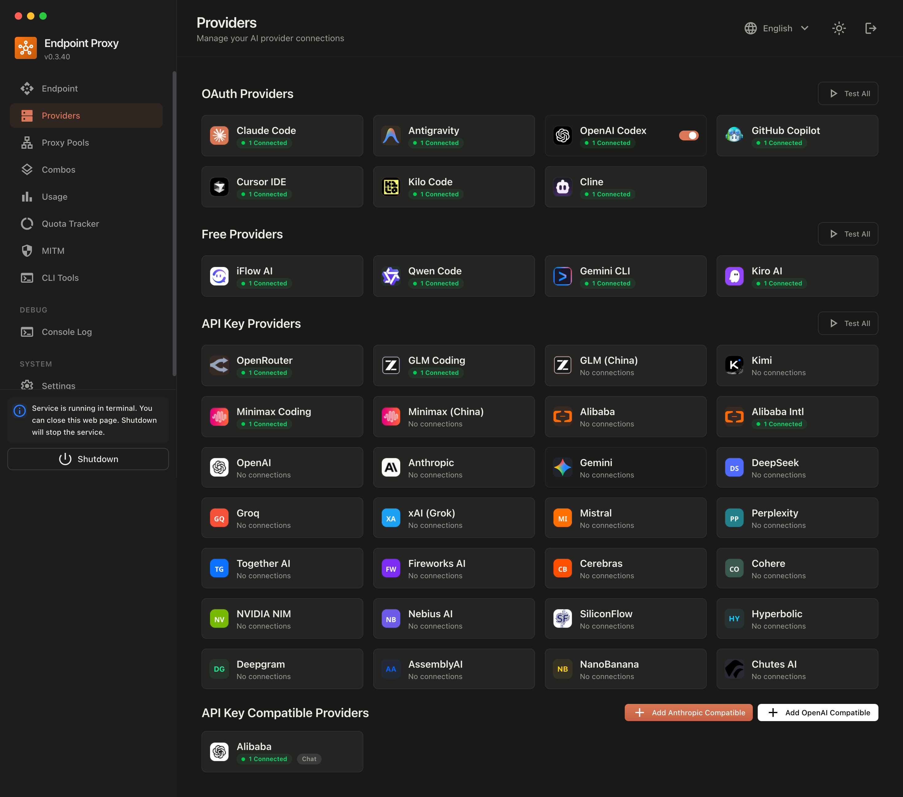

<div align="center">


A fork of [Decolua/9router](https://github.com/Decolua/9router) with extra features for everyone who wants them.

One gateway, one API key, any model: an OpenAI-compatible endpoint that routes to Claude, GPT, Gemini, Kimi, Qwen, GLM, DeepSeek, Grok and many more, with OAuth or your own accounts. This is still that router, with the parts I use daily changed and the rough edges fixed, free for anyone to use.

  

</div>

---

## Screenshots

<div align="center">



</div>

## Routing & Capabilities

9Router accepts requests in standard client formats (OpenAI Chat Completions, Anthropic Messages, or Gemini generateContent), translates them on-the-fly, and routes them to upstream providers through multiple connection tiers:

- **OAuth & Device Auth** - Connect official account sessions with automatic token refresh.
- **Direct API Keys** - Standard API key integration for enterprise and public AI cloud providers.
- **Free Tier Relay** - Zero-configuration routing for free developer and community AI gateways.
- **Web Cookie Sessions** - Reverse-engineered browser session adapters for direct consumer web platforms.
- **Local & Self-Hosted** - Connect local engines (Ollama, vLLM, LM Studio) and self-hosted instances.

Beyond text chat, the router natively exposes specialized endpoints for multimodal tasks: Text-to-Image, Image-to-Text, Video Generation, Text-to-Speech (TTS), Speech-to-Text (STT), Embeddings, and Web Search/Fetch.

## Architecture & Core Design

9Router functions as a unified gateway layer between AI client applications and model providers. It abstracts protocol differences, authentication mechanisms, and request lifecycle management so downstream tools only need to speak one standard interface.

- **Universal Protocol Adapter**: Ingests requests in OpenAI, Anthropic Claude, or Google Gemini format, translates them on-the-fly to the target provider's native schema, and transparently streams standardized responses back.
- **Unified Credential & Key Management**: Single interface for managing OAuth sessions, direct API keys, reverse-engineered web sessions, and custom local models.
- **Failover & Traffic Routing**: Dynamic routing policies including intelligent fallback chains, load balancing, model aliases, and latency-optimized dispatching.
- **Enterprise Controls**: Granular token quotas, rate limiting (RPM/TPM), budget caps, IP allowlisting, and automated state backups.

For granular version updates, newly added providers, and ongoing improvements, refer directly to the [CHANGELOG.md](./CHANGELOG.md).

## Getting started

```bash
git clone https://github.com/serenhope/9router.git
cd 9router
npm install
npm run dev          # dashboard on http://localhost:20127
```

Production:

```bash
npm run build
npm run start
```

Docker:

```bash
docker build -t 9router-fork .
docker run -d -p 20128:20128 -v 9router-data:/app/data 9router-fork
```

Once it is running:

| | |
| --- | --- |
| Dashboard | `http://localhost:20127/dashboard` (first login: `seren123`, or set `INITIAL_PASSWORD`) |
| OpenAI-compatible | `http://localhost:20127/v1` |
| Claude-compatible | `http://localhost:20127/v1/messages` |
| Gemini-native | `http://localhost:20127/v1beta/models/{model}:generateContent` |
| Health probe | `GET /api/health` |

Point any CLI tool or agent at the base URL, generate a key under **Endpoint & Key**, and you are done.

## Model names you can call

| Form | Example |
| --- | --- |
| Provider model | `kiro/claude-sonnet-4.5`, `kimi/kimi-k2.6`, `deepseek/deepseek-v4.1-pro` |
| Custom node | `mynode/gpt-oss-120b` |
| Combo | `my-combo` (fallback, round-robin, fusion and more) |
| Custom model | any name you define in Custom Models |

## Configuration

The app reads a few environment variables with sensible defaults; see [.env.example](./.env.example). State lives in `~/.9router` (SQLite database, backups, secrets).

## Credits

- Built on **[Decolua/9router](https://github.com/Decolua/9router)** - full credit to upstream for the router, the providers and the translators.
- Fork releases are tagged in [CHANGELOG.md](./CHANGELOG.md).
- License: **MIT**, same as upstream. See [LICENSE](./LICENSE).

---

<div align="center">

If this fork helped you, a star is appreciated.

[](https://github.com/serenhope/9router/stargazers)

</div>


