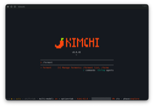
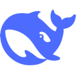
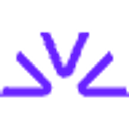
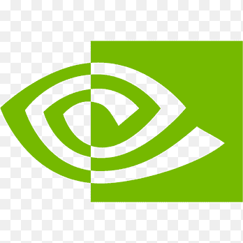
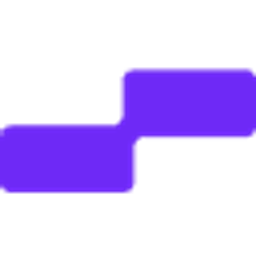

<div align="center">
  

  # 9Router - ÜCRETSİZ AI Yönlendirici ve Token Tasarrufu

  **Kodlamayı hiç bırakmayın. RTK + ücretsiz ve ucuz AI modellerine otomatik yedek geçiş (fallback) ile %20-40 token tasarrufu sağlayın.**

  **Tüm AI kod araçlarını (Claude Code, Cursor, Antigravity, Copilot, Codex, Gemini, OpenCode, Cline, OpenClaw...) 40+ AI sağlayıcısına ve 100+ modele bağlayın.**

  [](https://www.npmjs.com/package/9router)
  [](https://www.npmjs.com/package/9router)
  [](https://hub.docker.com/r/decolua/9router)
  [](https://github.com/decolua/9router/pkgs/container/9router)
  [](https://github.com/decolua/9router/blob/main/LICENSE)

<a href="https://trendshift.io/repositories/22628" target="_blank"></a>

[🚀 Hızlı Başlangıç](#-quick-start) • [💡 Özellikler](#-key-features) • [📖 Kurulum](#-setup-guide) • [🌐 Web Sitesi](https://9router.com)

[🇺🇸 English](../README.md) • [🇧🇷 Português (Brasil)](./README.pt-BR.md) • [🇻🇳 Tiếng Việt](./README.vi.md) • [🇨🇳 中文](./README.zh-CN.md) • [🇯🇵 日本語](./README.ja-JP.md) • [🇷🇺 Русский](./README.ru.md) • [🇹🇭 ไทย](./README.th.md) • [🇮🇷 فارسی](./README.fa_IR.md) • [🇮🇩 Indonesia](./README.id-ID.md) • [🇪🇸 Español](./README.es.md) • [🇫🇷 Français](./README.fr.md) • [🇹🇷 Türkçe](./README.tr.md)

</div>

---

## 🤔 Neden 9Router?

**Parayı, token'ları boşa harcamayı ve sınırlara takılmayı bırakın:**

- ❌ Abonelik kotası her ay kullanılmadan sona eriyor
- ❌ Hız sınırları sizi kodlamanın tam ortasında durduruyor
- ❌ Araç çıktıları (git diff, grep, ls...) token'ları hızla yakıyor
- ❌ Pahalı API'ler (sağlayıcı başına ayda $20-50)
- ❌ Sağlayıcılar arasında elle geçiş yapmak

**9Router bunu çözüyor:**

- ✅ **RTK Token Saver** - tool_result içeriğini otomatik sıkıştırır, istek başına %20-40 token tasarrufu
- ✅ **Abonelikleri sonuna kadar kullanın** - Kotayı izleyin, sıfırlanmadan önce her kırıntıyı değerlendirin
- ✅ **Otomatik yedek geçiş** - Abonelik → Ucuz → Ücretsiz, sıfır kesinti
- ✅ **Çoklu hesap** - Sağlayıcı başına hesaplar arasında sırayla döndürme
- ✅ **Evrensel** - Claude Code, Codex, Cursor, Cline ve her CLI aracıyla çalışır

---

## 🔄 Nasıl Çalışır

```
┌─────────────┐
│  Your CLI   │  (Claude Code, Codex, OpenClaw, Cursor, Cline...)
│   Tool      │
└──────┬──────┘
       │ http://localhost:20128/v1
       ↓
┌─────────────────────────────────────────────┐
│           9Router (Smart Router)            │
│  • RTK Token Saver (cut tool_result tokens) │
│  • Format translation (OpenAI ↔ Claude)     │
│  • Quota tracking                           │
│  • Auto token refresh                       │
└──────┬──────────────────────────────────────┘
       │
       ├─→ [Tier 1: SUBSCRIPTION] Claude Code, Codex, GitHub Copilot
       │   ↓ quota exhausted
       ├─→ [Tier 2: CHEAP] GLM ($0.6/1M), MiniMax ($0.2/1M)
       │   ↓ budget limit
       └─→ [Tier 3: FREE] Kiro, OpenCode Free, Vertex ($300 credits)

Result: Never stop coding, minimal cost + 20-40% token savings via RTK
```

---

## ⚡ Hızlı Başlangıç

**1. Global olarak kurun:**

```bash
npm install -g 9router
9router
```

🎉 Panel `http://localhost:20128` adresinde açılır

**2. ÜCRETSİZ bir sağlayıcı bağlayın (kayıt gerekmez):**

Panel → Providers → **Kiro AI** bağlayın (~ayda 50 kredi ücretsiz: Claude 4.5 + GLM-5 + MiniMax) veya **OpenCode Free** (kimlik doğrulama yok) → Hepsi bu!

**3. CLI aracınızda kullanın:**

```
Claude Code/Codex/OpenClaw/Cursor/Cline Ayarları:
  Endpoint: http://localhost:20128/v1
  API Key: [panelden kopyalayın]
  Model: kr/claude-sonnet-4.5
```

**Hepsi bu!** ÜCRETSİZ AI modelleriyle kodlamaya başlayın.

**Alternatif: kaynaktan çalıştırın (bu depo):**

Bu depodaki paket özeldir (`9router-app`), bu yüzden kaynaktan/Docker ile çalıştırmak beklenen yerel geliştirme yoludur.

```bash
cp .env.example .env
npm install
PORT=20128 NEXT_PUBLIC_BASE_URL=http://localhost:20128 npm run dev
```

Üretim modu:

```bash
# Derleme için geçici bellek oluşturun
sudo fallocate -l 2G /swapfile_temp
sudo chmod 600 /swapfile_temp
sudo mkswap /swapfile_temp
sudo swapon /swapfile_temp

export MAKEFLAGS="-j1"
export DLIB_NO_GUI_SUPPORT=1
export CFLAGS="-mno-avx"

npm run build

# Geçici takas alanını temizleyin
sudo swapoff /swapfile_temp
sudo rm /swapfile_temp

PORT=20128 HOSTNAME=0.0.0.0 NEXT_PUBLIC_BASE_URL=http://localhost:20128 npm run start
```

Varsayılan URL'ler:

- Panel: `http://localhost:20128/dashboard`
- OpenAI uyumlu API: `http://localhost:20128/v1`

---

## 🎥 Video Rehberleri

<div align="center">

<table>
  <tr>
    <td align="center" width="320">
      <a href="https://www.youtube.com/watch?v=X69n5Lm06Yw">
        
      </a><br/>
      <b>🇻🇳 Tiếng Việt</b><br/>
      <sub>Tiết kiệm chi phí LLM cho OpenClaw với 9Router<br/>by <a href="https://www.youtube.com/c/M%C3%ACAIblog">Mì AI</a></sub>
    </td>
    <td align="center" width="320">
      <a href="https://youtu.be/VQAw612S27Y">
        
      </a><br/>
      <b>🇵🇰 اردو / हिन्दी</b><br/>
      <sub>9Router + Claude Code FREE Unlimited Setup<br/>by <a href="https://www.youtube.com/@BuildAIWithHamid">Build AI With Hamid</a></sub>
    </td>
    <td align="center" width="320">
      <a href="https://www.youtube.com/watch?v=raEyZPg5xE0">
        
      </a><br/>
      <b>🇺🇸 English</b><br/>
      <sub>9Router + Claude Code FREE Setup<br/>by <a href="https://www.youtube.com/@BuildAIWithHamid">Build AI With Hamid</a></sub>
    </td>
    <td align="center" width="320">
      <a href="https://youtu.be/3dF5GIYMrcQ?si=bAyfyiHbARJQAHj_">
        
      </a><br/>
      <b>🇺🇸 English</b><br/>
      <sub>9Router + Claude Code FREE Setup<br/>by <a href="https://www.youtube.com/@BuildAIWithHamid">Build AI With Hamid</a></sub>
    </td>
    <td align="center" width="320">
      <a href="https://www.youtube.com/watch?v=o3qYCyjrFYg">
        
      </a><br/>
      <b>🇺🇸 English</b><br/>
      <sub>Claude Code FREE Forever — Unlimited Models<br/>by <a href="https://www.youtube.com/@BuildAIWithHamid">Build AI With Hamid</a></sub>
    </td>
  </tr>
  <tr>
    <td align="center" width="320">
      <a href="https://www.youtube.com/watch?v=Ttpc26m39Dw">
        
      </a><br/>
      <b>🇺🇸 English</b><br/>
      <sub>Claude CLI Free Setup with 9Router 🚀<br/>by <a href="https://www.youtube.com/@CodeVerseSoban">CodeVerse Soban</a></sub>
    </td>
    <td align="center" width="320">
      <a href="https://www.youtube.com/watch?v=G-5A_D5Pm6Y">
        
      </a><br/>
      <b>🇻🇳 Tiếng Việt</b><br/>
      <sub>Cài Đặt OpenClaw Free Từ A-Z + 9Router<br/>by <a href="https://www.youtube.com/@maigia">Mai Gia</a></sub>
    </td>
    <td align="center" width="320">
      <a href="https://www.youtube.com/watch?v=JXmg8_gccgE">
        
      </a><br/>
      <b>🇺🇸 English</b><br/>
      <sub>FREE OpenClaw + Claude Opus 4.6<br/>by <a href="https://www.youtube.com/@BuildAIWithHamid">Build AI With Hamid</a></sub>
    </td>
    <td align="center" width="320">
      <a href="https://www.youtube.com/watch?v=CkVZZUSTXAI">
        
      </a><br/>
      <b>🇮🇩 Indonesia</b><br/>
      <sub>Koding 24 Jam Anti Rate Limit! Hemat Token AI 65% | Tutorial Quick Setup 9Router 🚀<br/>by <a href="https://www.youtube.com/@krisswuh">Krisswuh</a></sub>
    </td>
    <td align="center" width="320">
      <a href="https://www.youtube.com/watch?v=TXGv4eofe1I">
        
      </a><br/>
      <b>🇮🇩 Indonesia</b><br/>
      <sub>Cara Deploy 9Router di Hugging Face GRATIS Non-Stop! | Alternatif VPS RAM 16GB<br/>by <a href="https://www.youtube.com/@krisswuh">Krisswuh</a></sub>
    </td>
  </tr>
  <tr>
    <td align="center" width="320">
      <a href="https://www.youtube.com/watch?v=GyX-DLvePW8">
        
      </a><br/>
      <b>🇮🇷 Persian-فارسی</b><br/>
      <sub dir="rtl">این شکلی از هر API ای استفاده کن برای هوش مصنوعی<br/>by <a href="https://www.youtube.com/@Matin_SenPai">Matin SenPai</a></sub>
    </td>
    <td align="center" width="320">
      <a href="https://www.youtube.com/watch?v=hPusYX-5Pmw">
        
      </a><br/>
      <b>🇻🇳 Tiếng Việt</b><br/>
      <sub>Hướng Dẫn Setup OpenClaw + 9Router: Tạo Bot Zalo AI Tự Động Từ A-Z<br/>by <a href="https://github.com/tuanminhhole">tuanminhhole</a></sub>
    </td>
    <td align="center" width="320">
      <a href="https://www.youtube.com/watch?v=hgnE7MKi3Y4">
        
      </a><br/>
      <b>🇮🇩 Indonesia</b><br/>
      <sub>Bye Limit! Cara Bikin Sistem "AI Unlimited" 100% Gratis Dengan 9Router!<br/>by <a href="https://www.youtube.com/@neptiver">neptiver</a></sub>
    </td>
    <td align="center" width="320"></td>
    <td align="center" width="320"></td>
  </tr>
</table>

</div>

> 🎬 **9Router hakkında video mu çektiniz?** Videonuzu bu bölüme ekleyen bir [Pull Request](https://github.com/decolua/9router/pulls) gönderin — birleştirelim!

---

## 🛠️ Desteklenen CLI Araçları

9Router tüm büyük AI kodlama araçlarıyla sorunsuz çalışır:

<div align="center">
  <table>
    <tr>
      <td align="center" width="120">
        <br/>
        <b>Claude-Code</b>
      </td>
      <td align="center" width="120">
        <br/>
        <b>OpenClaw</b>
      </td>
      <td align="center" width="120">
        <br/>
        <b>Codex</b>
      </td>
      <td align="center" width="120">
        <br/>
        <b>OpenCode</b>
      </td>
      <td align="center" width="120">
        <br/>
        <b>Cursor</b>
      </td>
      <td align="center" width="120">
        <br/>
        <b>Antigravity</b>
      </td>
    </tr>
    <tr>
      <td align="center" width="120">
        <br/>
        <b>Cline</b>
      </td>
      <td align="center" width="120">
        <br/>
        <b>Continue</b>
      </td>
      <td align="center" width="120">
        <br/>
        <b>Droid</b>
      </td>
      <td align="center" width="120">
        <br/>
        <b>Roo</b>
      </td>
      <td align="center" width="120">
        <br/>
        <b>Copilot</b>
      </td>
      <td align="center" width="120">
        <br/>
        <b>Kilo Code</b>
      </td>
    </tr>
    <tr>
      <td align="center" width="120">
        <br/>
        <b>OpenDesign</b>
      </td>
      <td align="center" width="120">
        <br/>
        <b>jcode</b>
      </td>
      <td align="center" width="120">
        <br/>
        <b>Grok Build</b>
      </td>
      <td align="center" width="120">
        <br/>
        <b>Devin CLI</b>
      </td>
      <td align="center" width="120">
        <br/>
        <b>DeepSeek TUI</b>
      </td>
      <td align="center" width="120">
        <br/>
        <b>Qwen Code</b>
      </td>
    </tr>
  </table>
</div>

---

## 🌐 Desteklenen Sağlayıcılar

### 🔐 OAuth Sağlayıcıları

<div align="center">
  <table>
    <tr>
      <td align="center" width="120">
        <br/>
        <b>Claude-Code</b>
      </td>
      <td align="center" width="120">
        <br/>
        <b>Antigravity</b>
      </td>
      <td align="center" width="120">
        <br/>
        <b>Codex</b>
      </td>
      <td align="center" width="120">
        <br/>
        <b>GitHub</b>
      </td>
      <td align="center" width="120">
        <br/>
        <b>Cursor</b>
      </td>
      <td align="center" width="120">
        <br/>
        <b>Kimchi</b>
      </td>
    </tr>
  </table>
</div>

### 🆓 Ücretsiz Sağlayıcılar

<div align="center">
  <table>
    <tr>
      <td align="center" width="150">
        <br/>
        <b>Kiro AI</b><br/>
        <sub>Claude 4.5 + GLM-5 + MiniMax<br/>ayda 50 kredi ücretsiz</sub>
      </td>
      <td align="center" width="150">
        <br/>
        <b>OpenCode Free</b><br/>
        <sub>Kimlik doğrulama yok • Modeller otomatik alınır<br/>Ücretsiz (model listesi değişir)</sub>
      </td>
      <td align="center" width="150">
        <br/>
        <b>Vertex AI</b><br/>
        <sub>Gemini 3 Pro + GLM-5 + DeepSeek<br/>$300 ücretsiz kredi</sub>
      </td>
    </tr>
  </table>
</div>

> **Not:** iFlow, Qwen Code ve Gemini CLI ücretsiz katmanları 2026'da kaldırıldı. Bunun yerine Kiro / OpenCode Free / Vertex kullanın.
>
> **Kiro AI** Eylül 2025'te ücretli modele geçti — ücretsiz katman artık **ayda 50 kredi** ile sınırlı (artı yeni hesaplar için ilk 30 günde 500 deneme kredisi). Ücretli katmanlar: Pro $20/ay (1.000 kredi), Pro+ $40/ay (2.000), Pro Max $100/ay (5.000), Power $200/ay (10.000).
> **OpenCode Free** model listesi zaman içinde değişir (bazı modeller yalnızca sınırlı kampanyalarda ücretsizdir) — önceden bildirilmeden değişebilir.
> **Vertex AI**: yeni GCP hesapları için $300 ücretsiz kredi hâlâ geçerli, ancak Mart 2026'dan itibaren **Gemini API uç noktası bu kredileri artık harcamıyor** — bunun yerine **Vertex AI Studio** uç noktasını çağırın.

### 🔑 API Anahtarı Sağlayıcıları (40+)

<div align="center">
  <table>
    <tr>
      <td align="center" width="100">
        <br/>
        <sub>OpenRouter</sub>
      </td>
      <td align="center" width="100">
        <br/>
        <sub>GLM</sub>
      </td>
      <td align="center" width="100">
        <br/>
        <sub>Kimi</sub>
      </td>
      <td align="center" width="100">
        <br/>
        <sub>MiniMax</sub>
      </td>
      <td align="center" width="100">
        <br/>
        <sub>OpenAI</sub>
      </td>
      <td align="center" width="100">
        <br/>
        <sub>Anthropic</sub>
      </td>
    </tr>
    <tr>
      <td align="center" width="100">
        <br/>
        <sub>Gemini</sub>
      </td>
      <td align="center" width="100">
        <br/>
        <sub>DeepSeek</sub>
      </td>
      <td align="center" width="100">
        <br/>
        <sub>Groq</sub>
      </td>
      <td align="center" width="100">
        <br/>
        <sub>xAI</sub>
      </td>
      <td align="center" width="100">
        <br/>
        <sub>Mistral</sub>
      </td>
      <td align="center" width="100">
        <br/>
        <sub>Perplexity</sub>
      </td>
    </tr>
    <tr>
      <td align="center" width="100">
        <br/>
        <sub>Together AI</sub>
      </td>
      <td align="center" width="100">
        <br/>
        <sub>Fireworks</sub>
      </td>
      <td align="center" width="100">
        <br/>
        <sub>Cerebras</sub>
      </td>
      <td align="center" width="100">
        <br/>
        <sub>Cohere</sub>
      </td>
      <td align="center" width="100">
        <br/>
        <sub>NVIDIA</sub>
      </td>
      <td align="center" width="100">
        <br/>
        <sub>SiliconFlow</sub>
      </td>
    </tr>
  </table>
  <p><i>...ve Nebius, Chutes, Hyperbolic ile özel OpenAI/Anthropic uyumlu uç noktalar dahil 20+ sağlayıcı daha</i></p>
</div>

### 🏠 Kendi Sunucunuzda Barındırılan Sağlayıcılar

**Kendi** makinenizden sunulan konuşma ve gömme (embedding) hizmetleri için — whisper.cpp, faster-whisper, Speaches, Kokoro-FastAPI, openedai-speech, llama.cpp/llama-server, vLLM, Infinity, text-embeddings-inference veya OpenAI biçimini konuşan başka her şey.

| Sağlayıcı | Kullanılan uç nokta | Tipik sunucu |
| --- | --- | --- |
| **Self-hosted STT** | `/v1/audio/transcriptions` | whisper.cpp, faster-whisper |
| **Self-hosted TTS** | `/v1/audio/speech` | Kokoro-FastAPI, openedai-speech |
| **Self-hosted Embedding** | `/v1/embeddings` | llama-server, vLLM, Infinity |

Diğer tüm konuşma sağlayıcıları sabit uç noktası olan adlandırılmış bulut hizmetleridir. Bu üçü adresini **her bağlantıdan** okur; böylece tek bir sağlayıcı birden çok makinenin önünde durabilir ve aralarında diğerleri gibi yük dengelemesi yapabilir.

Bağlantıda `providerSpecificData.baseUrl` olarak ayarlayın:

| Sağlayıcı | Vermeniz gereken | Sonuç |
| --- | --- | --- |
| Self-hosted STT | tam URL — `http://host:8080/v1/audio/transcriptions` | olduğu gibi kullanılır |
| Self-hosted TTS | sunucu kökü — `http://host:8880` | `+ /v1/audio/speech` |
| Self-hosted Embedding | **OpenAI tabanı**, `/v1` dahil — `http://host:8080/v1` | `+ /embeddings` |

> **Embedding'lerde `/v1` ayrıntısına dikkat edin.** Adaptör `/embeddings` ekler; bu yüzden `http://host:8080` adresi `http://host:8080/embeddings` olarak çözülür ve OpenAI rotasını ıskalar — llama-server **501** döner. Bir OpenAI istemcisinin kullanacağı taban URL'nin aynısını verin. Tam `.../v1/embeddings` de kabul edilir, yani bir `curl` örneğinden kopyalanan değer de çalışır.

API anahtarı çoğu yerel sunucu tarafından kontrol edilmez, ancak alan boş bırakılamaz: bağlantıya bir kimlik bilgisi kaydı kazandıran odur ve `baseUrl` orada yaşar. Herhangi bir yer tutucu işe yarar.

Self-hosted Embedding **tasarım gereği buluta yedek geçiş yapmaz** — `baseUrl` olmadan kaydedilen bir bağlantı, sessizce `api.openai.com`'a düşmek yerine yapılandırma hatası olarak bildirilir; çünkü bu, girdi metninizi ve API anahtarınızı "Self-hosted" adlı bir sağlayıcı altında üçüncü bir tarafa gönderirdi.

---

## 💡 Öne Çıkan Özellikler

| Özellik                                                                            | Ne Yapar                                                                                  | Neden Önemli                                       |
| ---------------------------------------------------------------------------------- | ----------------------------------------------------------------------------------------- | -------------------------------------------------- |
| 🚀 **RTK Token Saver** ([RTK](https://github.com/rtk-ai/rtk) ⭐40K)                | LLM'e göndermeden önce araç çıktılarını (`git diff`, `grep`, `ls`, `tree`...) sıkıştırır   | İstek başına **%20-40 girdi token'ı** tasarrufu    |
| 🧠 **Headroom Token Saver** ([Headroom](https://github.com/chopratejas/headroom))  | Sağlayıcı yönlendirmesinden önce isteğe bağlı harici `/v1/compress` proxy'si               | İstemcileri değiştirmeden daha fazla bağlam token'ı |
| 🪨 **Caveman Mode** ([Caveman](https://github.com/JuliusBrussee/caveman) ⭐52K)    | Mağara adamı konuşması istemi ekler → LLM kısa yanıtlar, teknik içerik korunur             | **Çıktı token'larında %65'e kadar** tasarruf       |
| 🐴 **Ponytail** ([Ponytail](https://github.com/DietrichGebert/ponytail))           | "Tembel kıdemli geliştirici" istemi ekler → LLM minimal, önce-YAGNI kod yazar (Lite/Full/Ultra) | **Daha az çıktı token'ı, daha az refactor**    |
| 🎯 **Akıllı 3 Katmanlı Yedek Geçiş**                                               | Otomatik yönlendirme: Abonelik → Ucuz → Ücretsiz                                          | Kodlama hiç durmaz, sıfır kesinti                  |
| 📊 **Gerçek Zamanlı Kota Takibi**                                                  | Canlı token sayısı + sıfırlama geri sayımı                                                | Abonelik değerini en üst düzeye çıkarır            |
| 🔄 **Format Dönüşümü**                                                             | OpenAI ↔ Claude ↔ Gemini ↔ Cursor ↔ Kiro ↔ Vertex                                         | Her CLI aracıyla çalışır                           |
| 👥 **Çoklu Hesap Desteği**                                                         | Sağlayıcı başına birden çok hesap                                                         | Yük dengeleme + yedeklilik                         |
| 🔄 **Otomatik Token Yenileme**                                                     | OAuth token'ları otomatik yenilenir                                                       | Elle yeniden giriş gerekmez                        |
| 🎨 **Özel Kombolar**                                                               | Sınırsız model kombinasyonu oluşturun                                                     | Yedek geçişi ihtiyacınıza göre uyarlayın           |
| 📝 **İstek Günlükleme**                                                            | Tam istek/yanıt günlükleriyle hata ayıklama modu                                          | Sorunları kolayca giderin                          |
| 💾 **Bulut Eşitleme**                                                              | Yapılandırmayı cihazlar arasında eşitleyin                                                | Her yerde aynı kurulum                             |
| 📊 **Kullanım Analitiği**                                                          | Token'ları, maliyeti ve zaman içindeki eğilimleri izleyin                                | Harcamaları optimize edin                          |
| 🌐 **Her Yerde Dağıtım**                                                           | Localhost, VPS, Docker, Cloudflare Workers                                                | Esnek dağıtım seçenekleri                          |

Tek bir sohbet isteğinde tüm token tasarruf özelliklerini atlamak için `X-9Router-Token-Saver: off` ayarlayın.

<details>
<summary><b>📖 Özellik Ayrıntıları</b></summary>

### 🚀 RTK Token Saver

Araç çıktıları (`git diff`, `grep`, `find`, `ls`, `tree`, günlük dökümleri...) genellikle istem bütçenizin %30-50'sini yer. RTK bunları algılar ve istek LLM'e ulaşmadan **önce** akıllı, kayıpsız sıkıştırma uygular:

- **Filtreler:** `git-diff`, `git-status`, `grep`, `find`, `ls`, `tree`, `dedup-log`, `smart-truncate`, `read-numbered`, `search-list`
- **Otomatik algılama:** Yapılandırma gerekmez — RTK her `tool_result`'ın ilk 1KB'ına bakar ve doğru filtreyi seçer.
- **Tasarım gereği güvenli:** Bir filtre başarısız olur, hata verir ya da çıktıyı büyütürse RTK sessizce özgün metni korur. Hatalar isteğinizi asla bozmaz.
- **Evrensel:** Her formatta çalışır (OpenAI, Claude, Gemini, Cursor, Kiro, OpenAI Responses), çünkü herhangi bir format dönüşümünden **önce** çalışır.
- **Varsayılan olarak açık:** Panel → Endpoint ayarlarından istediğiniz zaman değiştirin.

```
RTK olmadan: LLM'e 47K token gönderilir
RTK ile:     LLM'e 28K token gönderilir   (%40 tasarruf · aynı bağlam · aynı yanıt)
```

### 🧠 Headroom Token Saver

Headroom isteğe bağlıdır ve ayrı çalışır. 9Router, Headroom'un yerel `/v1/compress` uç noktasını çağırır, ardından normal yönlendirme, yedek geçiş, kimlik doğrulama ve kullanım takibine devam eder:

```
İstemci → 9Router → Headroom /v1/compress → 9Router → sağlayıcı
```

Yerel kurulum:

```bash
pip install "headroom-ai[proxy]"
headroom proxy --port 8787
```

Panel → Endpoint → Token Saver → Headroom'dan etkinleştirin. Varsayılan URL: `http://localhost:8787`.

Docker örnekleri:

```bash
# Aynı Docker ağındaki Headroom servisi
http://headroom:8787

# Ana makinede çalışan Headroom
http://host.docker.internal:8787
```

Headroom kapalıysa veya hata döndürürse 9Router akışı kesmez ve özgün isteği gönderir.

### 🐴 Ponytail (Tembel Kıdemli Geliştirici)

Ponytail her isteğe bir _"tembel kıdemli geliştirici"_ sistem istemi ekler ve LLM'i minimal, önce-YAGNI koda yönlendirir — ekleme yerine silme, yeni bağımlılık yerine standart kütüphane, soyutlama yerine tek satır. [DietrichGebert/ponytail](https://github.com/DietrichGebert/ponytail) projesinden uyarlanmıştır.

- **Lite** — İsteneni yapın, daha tembel alternatifi adlandırın.
- **Full** — YAGNI merdiveni zorunlu: standart kütüphane → yerel → mevcut bağımlılıklar → tek satır → minimal kod.
- **Ultra** — YAGNI aşırıcısı: önce silme, tek satırı gönderin, gereksinimin kalanını aynı yanıtta sorgulayın.

```
Ponytail olmadan: ayrıntılı kod, fazladan soyutlamalar, "belki lazım olur" iskeleti
Ponytail ile:     en kısa çalışan diff, istenmeyen soyutlama yok, daha az token
```

Asla taviz vermez: girdi doğrulama, veri kaybını önleyen hata yönetimi, güvenlik, erişilebilirlik veya açıkça istenen her şey. Panel → Endpoint → Ponytail'den etkinleştirin. Caveman (çıktı kısalığı) ve RTK (girdi sıkıştırma) ile birlikte kullanılır.

### 🎯 Akıllı 3 Katmanlı Yedek Geçiş

Otomatik yedek geçişli kombolar oluşturun:

```
Combo: "my-coding-stack"
  1. cc/claude-opus-4-6        (aboneliğiniz)
  2. glm/glm-4.7               (ucuz yedek, $0.6/1M)
  3. if/kimi-k2-thinking       (ücretsiz yedek geçiş)

→ Kota bittiğinde veya hata oluştuğunda otomatik geçer
```

### 📊 Gerçek Zamanlı Kota Takibi

- Sağlayıcı başına token tüketimi
- Sıfırlama geri sayımı (5 saatlik, günlük, haftalık)
- Ücretli katmanlar için maliyet tahmini
- Aylık harcama raporları

### 🔄 Format Dönüşümü

Formatlar arasında sorunsuz dönüşüm:

- **OpenAI** ↔ **Claude** ↔ **Gemini** ↔ **Cursor** ↔ **Kiro** ↔ **Vertex** ↔ **Antigravity** ↔ **Ollama** ↔ **OpenAI Responses**
- CLI aracınız OpenAI formatında gönderir → 9Router dönüştürür → Sağlayıcı yerel formatı alır
- Özel OpenAI uç noktalarını destekleyen her araçla çalışır

### 👥 Çoklu Hesap Desteği

- Sağlayıcı başına birden çok hesap ekleyin
- Otomatik sırayla döndürme veya öncelik tabanlı yönlendirme
- Bir hesap kotaya takıldığında bir sonraki hesaba geçer

### 🔄 Otomatik Token Yenileme

- OAuth token'ları süresi dolmadan önce otomatik yenilenir
- Elle yeniden kimlik doğrulama gerekmez
- Tüm sağlayıcılarda sorunsuz deneyim

### 🎨 Özel Kombolar

- Sınırsız model kombinasyonu oluşturun
- Abonelik, ucuz ve ücretsiz katmanları karıştırın
- Kolay erişim için kombolarınızı adlandırın
- Bulut Eşitleme ile komboları cihazlar arasında paylaşın

### 📝 İstek Günlükleme

- Tam istek/yanıt günlükleri için hata ayıklama modunu açın
- API çağrılarını, başlıkları ve yükleri izleyin
- Entegrasyon sorunlarını giderin
- Günlükleri analiz için dışa aktarın

### 💾 Bulut Eşitleme

- Sağlayıcıları, komboları ve ayarları cihazlar arasında eşitleyin
- Otomatik arka plan eşitleme
- Güvenli şifreli depolama
- Kurulumunuza her yerden erişin

#### Bulut Çalışma Zamanı Notları

- Üretimde sunucu tarafı bulut değişkenlerini tercih edin:
  - `BASE_URL` (eşitleme zamanlayıcısının kullandığı dahili geri çağırma URL'si)
  - `CLOUD_URL` (bulut eşitleme uç noktası tabanı)
- `NEXT_PUBLIC_BASE_URL` ve `NEXT_PUBLIC_CLOUD_URL` uyumluluk/arayüz için hâlâ desteklenir, ancak sunucu çalışma zamanı artık `BASE_URL`/`CLOUD_URL` değişkenlerine öncelik verir.
- Bulut eşitleme istekleri artık zaman aşımı + hızlı başarısız davranışı kullanır; böylece bulut DNS/ağı kullanılamadığında arayüz donmaz.

### 📊 Kullanım Analitiği

- Sağlayıcı ve model başına token kullanımını izleyin
- Maliyet tahmini ve harcama eğilimleri
- Aylık raporlar ve içgörüler
- AI harcamalarınızı optimize edin

> **💡 ÖNEMLİ - Panel Maliyetlerini Anlamak:**
>
> Kullanım Analitiği'nde gösterilen "maliyet" **yalnızca izleme ve karşılaştırma amaçlıdır**.
> 9Router size **hiçbir ücret kesmez**. Ücreti yalnızca sağlayıcılara doğrudan ödersiniz (ücretli hizmet kullanıyorsanız).
>
> **Örnek:** Kiro ücretsiz modellerini kullanırken paneliniz "$290 toplam maliyet" gösteriyorsa bu,
> ücretli API'leri doğrudan kullansaydınız ödeyeceğiniz tutarı temsil eder. Gerçek maliyetiniz = **$0** (Kiro ücretsiz katmanı: ~50 kredi/ay).
>
> Bunu, ücretsiz modeller kullanarak veya 9Router üzerinden yönlendirerek ne kadar tasarruf
> ettiğinizi gösteren bir "tasarruf takibi" olarak düşünün!

### 🌐 Her Yerde Dağıtım

- 💻 **Localhost** - Varsayılan, çevrimdışı çalışır
- ☁️ **VPS/Bulut** - Cihazlar arasında paylaşın
- 🐳 **Docker** - Tek komutla dağıtım
- 🚀 **Cloudflare Workers** - Küresel uç ağı

</details>

---

## 💰 Fiyatlara Genel Bakış

| Katman              | Sağlayıcı             | Maliyet      | Kota Sıfırlama   | En Uygun Kullanım                       |
| ------------------- | --------------------- | ------------ | ---------------- | --------------------------------------- |
| **🚀 TOKEN TASARRUFU** | **RTK (yerleşik)** | **ÜCRETSİZ** | Her zaman açık   | **HER istekte %20-40 token tasarrufu**  |
| **💳 ABONELİK**     | Claude Code (Pro/Max) | $20-200/ay   | 5 sa + haftalık  | Zaten abone olanlar                     |
|                     | Codex (Plus/Pro)      | $20-200/ay   | 5 sa + haftalık  | OpenAI kullanıcıları                    |
|                     | GitHub Copilot        | $10-19/ay    | Aylık            | GitHub kullanıcıları                    |
|                     | Cursor IDE            | $20/ay       | Aylık            | Cursor kullanıcıları                    |
| **💰 UCUZ**         | GLM-5.1 / GLM-4.7     | $0.6/1M      | Her gün 10:00    | Bütçe yedeği                            |
|                     | MiniMax M2.7          | $0.2/1M      | 5 saatlik kayan  | En ucuz seçenek                         |
|                     | Kimi K2.5             | $9/ay sabit  | 10M token/ay     | Öngörülebilir maliyet                   |
 | **🆓 ÜCRETSİZ**    | Kiro AI               | $0           | 50 kredi/ay      | Claude 4.5 + GLM-5 + MiniMax ücretsiz (ücretli katmanlar yukarıda) |
 |                     | OpenCode Free         | $0           | Değişken*        | Kimlik doğrulama yok, modeller otomatik alınır (liste zamanla değişir) |
 |                     | Vertex AI             | $300 kredi   | Yeni GCP hesapları | Gemini 3 Pro + DeepSeek + GLM-5 (ücretsiz krediler için Vertex AI Studio uç noktasını kullanın) |

**💡 İpucu:** RTK + Kiro AI + OpenCode Free kombosu = **$0 maliyet + %20-40 token tasarrufu**!

---

### 📊 9Router Maliyetlerini ve Faturalamayı Anlamak

**9Router Faturalama Gerçeği:**

✅ **9Router yazılımı = sonsuza kadar ÜCRETSİZ** (açık kaynak, asla ücret kesmez)
✅ **Panel "maliyetleri" = yalnızca gösterim/izleme** (gerçek fatura değil)
✅ **Ödemeyi doğrudan sağlayıcılara yaparsınız** (abonelikler veya API ücretleri)
✅ **ÜCRETSİZ sağlayıcılar ÜCRETSİZ kalır** (Kiro ~50 kredi/ay, OpenCode Free, Vertex $300 kredi = ücretsiz katman sınırları içinde $0) — iFlow/Qwen/Gemini CLI ücretsiz katmanlarının 2026'da kaldırıldığını unutmayın
❌ **9Router asla fatura göndermez** veya kartınızdan çekim yapmaz

**Maliyet Gösterimi Nasıl Çalışır:**

Panel, ücretli API'leri doğrudan kullanıyormuşsunuz gibi **tahmini maliyetler** gösterir. Bu **faturalama değildir** — tasarrufunuzu göstermeye yarayan bir karşılaştırma aracıdır.

**Örnek Senaryo:**

```
Panel Gösterimi:
• Toplam İstek: 1,662
• Toplam Token: 47M
• Gösterilen Maliyet: $290

Gerçek Durum:
• Sağlayıcı: Kiro (ücretsiz katman: ~50 kredi/ay)
• Gerçek Ödeme: $0.00
• $290 Ne Anlama Geliyor: Ücretsiz modeller kullanarak TASARRUF ettiğiniz tutar!
```

**Ödeme Kuralları:**

- **Abonelik sağlayıcıları** (Claude Code, Codex): Ücreti web sitelerinden doğrudan ödeyin
- **Ucuz sağlayıcılar** (GLM, MiniMax): Ücreti doğrudan ödeyin, 9Router yalnızca yönlendirir
- **ÜCRETSİZ sağlayıcılar** (iFlow, Kiro, Qwen): Gerçekten sonsuza kadar ücretsiz, gizli ücret yok
- **9Router**: Hiçbir zaman hiçbir ücret kesmez

---

## 🎯 Kullanım Senaryoları

### Senaryo 1: "Claude Pro aboneliğim var"

**Sorun:** Kota kullanılmadan sona eriyor, yoğun kodlamada hız sınırları

**Çözüm:**

```
Combo: "maximize-claude"
  1. cc/claude-opus-4-7        (aboneliği sonuna kadar kullan)
  2. glm/glm-5.1               (kota bitince ucuz yedek)
  3. kr/claude-sonnet-4.5      (ücretsiz acil yedek geçiş)

Monthly cost: $20 (abonelik) + ~$5 (yedek) = toplam $25
vs. $20 + sınırlara takılmak = hüsran
```

### Senaryo 2: "Sıfır maliyet istiyorum"

**Sorun:** Abonelikleri karşılayamıyorum, güvenilir AI kodlamaya ihtiyacım var

**Çözüm:**

```
Combo: "free-forever"
  1. kr/claude-sonnet-4.5      (Kiro üzerinden Claude 4.5 ücretsiz, ~50 kredi/ay)
  2. kr/glm-5                  (Kiro üzerinden GLM-5 ücretsiz)
  3. oc/<auto>                 (OpenCode Free, kimlik doğrulama yok)

Monthly cost: $0
Quality: Üretime hazır modeller + RTK %20-40 token tasarrufu
```

### Senaryo 3: "7/24 kesintisiz kodlama istiyorum"

**Sorun:** Teslim tarihleri var, kesinti lüksü yok

**Çözüm:**

```
Combo: "always-on"
  1. cc/claude-opus-4-7        (en iyi kalite)
  2. cx/gpt-5.5                (ikinci abonelik)
  3. glm/glm-5.1               (ucuz, her gün sıfırlanır)
  4. minimax/MiniMax-M2.7      (en ucuz, 5 sa sıfırlama)
  5. kr/claude-sonnet-4.5      (Kiro üzerinden ücretsiz, ~50 kredi/ay)

Result: 5 katmanlı yedek geçiş = sıfır kesinti
Monthly cost: $20-200 (abonelikler) + $10-20 (yedek)
```

### Senaryo 4: "OpenClaw'da ÜCRETSİZ AI istiyorum"

**Sorun:** Mesajlaşma uygulamalarında (WhatsApp, Telegram, Slack...) tamamen ücretsiz bir AI asistanı gerekiyor

**Çözüm:**

```
Combo: "openclaw-free"
  1. kr/claude-sonnet-4.5      (Claude 4.5 ücretsiz)
  2. kr/glm-5                  (GLM-5 ücretsiz)
  3. kr/MiniMax-M2.5           (MiniMax ücretsiz)

Monthly cost: $0
Access via: WhatsApp, Telegram, Slack, Discord, iMessage, Signal...
```

---

## ❓ Sıkça Sorulan Sorular

<details>
<summary><b>📊 Panelim neden yüksek maliyetler gösteriyor?</b></summary>

Panel token kullanımınızı izler ve ücretli API'leri doğrudan kullanıyormuşsunuz gibi **tahmini maliyetler** gösterir. Bu **gerçek faturalama değildir** — ücretsiz modelleri veya mevcut aboneliklerinizi 9Router üzerinden kullanarak ne kadar tasarruf ettiğinizi göstermeye yarayan bir referanstır.

**Örnek:**

- **Panel şunu gösterir:** "$290 toplam maliyet"
- **Gerçek:** Kiro ücretsiz modellerini kullanıyorsunuz (~50 kredi/ay)
- **Gerçek maliyetiniz:** **$0.00**
- **$290 ne anlama gelir:** Ücretli API'ler yerine ücretsiz modeller kullanarak **tasarruf ettiğiniz** tutar!

Maliyet göstergesi, kullanım alışkanlıklarınızı ve optimizasyon fırsatlarını anlamanıza yardımcı olan bir "tasarruf takibi"dir.

</details>

<details>
<summary><b>💳 9Router benden ücret alacak mı?</b></summary>

**Hayır.** 9Router kendi bilgisayarınızda çalışan ücretsiz, açık kaynaklı yazılımdır. Size asla ücret kesmez.

**Yalnızca şunlar için ödeme yaparsınız:**

- ✅ **Abonelik sağlayıcıları** (Claude Code $20/ay, Codex $20-200/ay) → Ücreti web sitelerinden doğrudan ödeyin
- ✅ **Ucuz sağlayıcılar** (GLM, MiniMax) → Ücreti doğrudan ödeyin, 9Router yalnızca isteklerinizi yönlendirir
- ❌ **9Router'ın kendisi** → **Hiçbir zaman hiçbir ücret kesmez**

9Router yerel bir proxy/yönlendiricidir. Kredi kartınız onda değildir, fatura gönderemez ve faturalama sistemi yoktur. Tamamen ücretsiz bir yazılımdır.

</details>

<details>
<summary><b>🆓 ÜCRETSİZ sağlayıcılar gerçekten sınırsız mı?</b></summary>

**Çoğunlukla evet!** Mevcut ÜCRETSİZ sağlayıcılar (Kiro, OpenCode Free, Vertex) gerçekten ücretsizdir, ancak ücretsiz katmanların sınırları vardır:

Bunlar, ilgili şirketlerin sunduğu ücretsiz hizmetlerdir:

- **Kiro AI**: AWS Builder ID / Google / GitHub OAuth ile ayda ~50 kredi ücretsiz (artı yeni hesaplar için ilk 30 günde 500 deneme kredisi). Bunun üzerinde ücretli katmanlar mevcuttur.
- **OpenCode Free**: Kimlik doğrulamasız geçiş proxy'si, modeller `opencode.ai/zen/v1/models` adresinden otomatik alınır. Ücretsiz model listesi zaman içinde değişir (bazı modeller yalnızca sınırlı kampanyalarda ücretsizdir) — önceden bildirilmeden değişebilir.
- **Vertex AI**: yeni Google Cloud hesapları için $300 ücretsiz kredi (90 gün). Mart 2026'dan itibaren Gemini API uç noktası bu kredileri artık harcamıyor — bunun yerine **Vertex AI Studio** uç noktasını kullanın.

9Router yalnızca isteklerinizi onlara yönlendirir — 9Router tarafında bir "oyun" veya gelecekte faturalama yoktur. Gerçekten ücretsiz hizmetlerdir ve 9Router bunları yedek geçiş desteğiyle kolayca kullanmanızı sağlar.

**Kaldırılan ücretsiz katmanlar (artık önerilmiyor):**

- ❌ **iFlow**: Sınırsız ücretsizdi, 2026'da ücretliye geçti
- ❌ **Qwen Code**: Ücretsiz OAuth katmanı Alibaba tarafından 2026-04-15'te tamamen kaldırıldı
- ❌ **Gemini CLI**: Hizmet Google tarafından 2026-06-18'te tamamen kapatıldı (yerini kapalı kaynaklı Antigravity CLI aldı). Kaldırıldı — kullanmayın.

</details>

<details>
<summary><b>💰 Gerçek AI maliyetlerimi nasıl en aza indiririm?</b></summary>

**Önce Ücretsiz Stratejisi:**

1. **%100 ücretsiz komboyla başlayın:**

   ```
   1. kr/glm-5 (Kiro üzerinden GLM-5 ücretsiz, ~50 kredi/ay)
   2. OpenCode Free modelleri (kimlik doğrulama yok, otomatik alınır)
   3. Vertex AI Gemini 3 Pro (Vertex AI Studio uç noktası ve $300 kredi ile)
   ```

   **Maliyet: $0/ay** (Kiro'nun ücretsiz kredi sınırı dahilinde; OpenCode/Vertex kendi ücretsiz katman sınırlarına tabidir)

2. **Ucuz yedek ekleyin**, yalnızca ihtiyacınız varsa:

   ```
   4. glm/glm-4.7 ($0.6/1M token)
   ```

   **Ek maliyet: Yalnızca gerçekten kullandığınız kadar ödeyin**

3. **Abonelik sağlayıcılarını en sona bırakın:**
   - Yalnızca zaten sahipseniz
   - 9Router kota takibiyle değerlerini en üst düzeye çıkarmaya yardımcı olur

**Sonuç:** Çoğu kullanıcı yalnızca ücretsiz katmanları kullanarak ayda $0 ile çalışabilir!

</details>

<details>
<summary><b>📈 Kullanımım aniden artarsa ne olur?</b></summary>

9Router'ın akıllı yedek geçişi sürpriz ücretleri önler:

**Senaryo:** Yoğun bir kodlama maratonundasınız ve kotalarınızı tükettiniz

**9Router olmadan:**

- ❌ Hız sınırına takılırsınız → İş durur → Hüsran
- ❌ Ya da: Yanlışlıkla devasa API faturaları biriktirirsiniz

**9Router ile:**

- ✅ Abonelik sınıra ulaşır → Ucuz katmana otomatik yedek geçiş
- ✅ Ucuz katman pahalanır → Ücretsiz katmana otomatik yedek geçiş
- ✅ Kodlama hiç durmaz → Öngörülebilir maliyetler

**Kontrol sizde:** Panelde sağlayıcı başına harcama limiti belirleyin, 9Router bunlara uyar.

</details>

---

## 📖 Kurulum Rehberi

<details>
<summary><b>🔐 Abonelik Sağlayıcıları (Değeri En Üst Düzeye Çıkarın)</b></summary>

### Claude Code (Pro/Max)

```bash
Dashboard → Providers → Connect Claude Code
→ OAuth login → Auto token refresh
→ 5-hour + weekly quota tracking

Models:
  cc/claude-opus-4-7
  cc/claude-opus-4-6
  cc/claude-sonnet-4-6
  cc/claude-haiku-4-5-20251001
```

**İpucu:** Karmaşık görevler için Opus, hız için Sonnet kullanın. 9Router kotayı model başına izler!

### OpenAI Codex (Plus/Pro)

```bash
Dashboard → Providers → Connect Codex
→ OAuth login (port 1455)
→ 5-hour + weekly reset

Models:
  cx/gpt-5.5
  cx/gpt-5.4
  cx/gpt-5.3-codex
  cx/gpt-5.2-codex
```

### GitHub Copilot

```bash
Dashboard → Providers → Connect GitHub
→ OAuth via GitHub
→ Monthly reset (1st of month)

Models:
  gh/gpt-5.4
  gh/claude-opus-4.7
  gh/claude-sonnet-4.6
  gh/gemini-3.1-pro-preview
  gh/grok-code-fast-1
```

### Cursor IDE

```bash
Dashboard → Providers → Connect Cursor
→ OAuth login
→ Monthly subscription

Models:
  cu/claude-4.6-opus-max
  cu/claude-4.5-sonnet-thinking
  cu/gpt-5.3-codex
```

</details>

<details>
<summary><b>💰 Ucuz Sağlayıcılar (Yedek)</b></summary>

### GLM-5.1 / GLM-4.7 (Günlük sıfırlama, $0.6/1M)

1. Kaydolun: [Zhipu AI](https://open.bigmodel.cn/)
2. Coding Plan'dan API anahtarı alın
3. Panel → Add API Key:
   - Provider: `glm`
   - API Key: `your-key`

**Kullanım:** `glm/glm-5.1`, `glm/glm-5`, `glm/glm-4.7`

**İpucu:** Coding Plan 1/7 maliyetle 3× kota sunar! Her gün 10:00'da sıfırlanır.

### MiniMax M2.7 (5 sa sıfırlama, $0.20/1M)

1. Kaydolun: [MiniMax](https://www.minimax.io/)
2. API anahtarı alın
3. Panel → Add API Key

**Kullanım:** `minimax/MiniMax-M2.7`, `minimax/MiniMax-M2.5`

**İpucu:** Uzun bağlam (1M token) için en ucuz seçenek!

### Kimi K2.5 ($9/ay sabit)

1. Abone olun: [Moonshot AI](https://platform.moonshot.ai/)
2. API anahtarı alın
3. Panel → Add API Key

**Kullanım:** `kimi/kimi-k2.5`, `kimi/kimi-k2.5-thinking`

**İpucu:** 10M token için sabit $9/ay = efektif $0.90/1M maliyet!

</details>

<details>
<summary><b>🆓 ÜCRETSİZ Sağlayıcılar (Önerilen)</b></summary>

### Kiro AI (Claude 4.5 + GLM-5 + MiniMax ÜCRETSİZ)

```bash
Dashboard → Connect Kiro
→ AWS Builder ID, AWS IAM Identity Center, Google, or GitHub
→ Unlimited usage

Models:
  kr/claude-sonnet-4.5
  kr/claude-haiku-4.5
  kr/glm-5
  kr/MiniMax-M2.5
  kr/qwen3-coder-next
  kr/deepseek-3.2
```

**İpucu:** Claude için en iyi ücretsiz seçenek. API anahtarı yok, ödeme yok, tamamen sınırsız.

### OpenCode Free (Kimlik doğrulama yok, modeller otomatik alınır)

```bash
Dashboard → Connect OpenCode Free
→ No login required (passthrough proxy)
→ Models auto-fetched from opencode.ai/zen/v1/models
```

**İpucu:** En hızlı kurulum. Bağlanın ve kodlamaya başlayın.

### Vertex AI (yeni GCP hesapları için $300 ücretsiz kredi)

```bash
Dashboard → Connect Vertex AI
→ Upload Google Cloud Service Account JSON
→ Enable Vertex AI API in your GCP project

Models:
  vertex/gemini-3.1-pro-preview
  vertex/gemini-3-flash-preview
  vertex/gemini-2.5-flash

Vertex Partner (Anthropic / DeepSeek / GLM / Qwen via Vertex):
  vertex-partner/glm-5-maas
  vertex-partner/deepseek-v3.2-maas
  vertex-partner/qwen3-next-80b-a3b-thinking-maas
```

Ham Google Cloud API anahtarı bağlantısı için genel uç noktayı seçmek üzere `PUT /api/providers/<connection-id>` üzerinden şunları ayarlayın:

```json
{
  "providerSpecificData": {
    "projectId": "YOUR_GOOGLE_CLOUD_PROJECT_ID",
    "location": "global"
  }
}
```

Açık bir proje verildiğinde API anahtarı istekleri `location` değerine uyar ve belirtilmezse `global` varsayılanını kullanır. Açık projesi olmayan bağlantılar projesiz uç noktayı korur. Gemini 4 Argon `global`, `us` ve `eu` destekler; `europe-west1` gibi bölgesel konumları desteklemez; bkz. [Google'ın desteklenen konumları](https://docs.cloud.google.com/gemini-enterprise-agent-platform/models/gemini/4-argon).

**İpucu:** Yeni Google Cloud hesapları 90 gün boyunca $300 ücretsiz kredi alır. Günlük kodlama için fazlasıyla yeterli.

</details>

<details>
<summary><b>🎨 Kombo Oluşturma</b></summary>

### Örnek 1: Aboneliği En Üst Düzeye Çıkarın → Ucuz Yedek

```
Panel → Combos → Create New

Name: premium-coding
Models:
  1. cc/claude-opus-4-7 (birincil abonelik)
  2. glm/glm-5.1 (ucuz yedek, $0.6/1M)
  3. minimax/MiniMax-M2.7 (en ucuz yedek geçiş, $0.20/1M)

CLI'da kullanım: premium-coding

Aylık maliyet örneği (100M token):
  80M Claude üzerinden (abonelik): ek $0
  15M GLM üzerinden: $9
  5M MiniMax üzerinden: $1
  Total: $10 + aboneliğiniz
```

### Örnek 2: Yalnızca Ücretsiz (Sıfır Maliyet)

```
Name: free-combo
Models:
  1. kr/claude-sonnet-4.5 (Kiro üzerinden Claude 4.5 ücretsiz, ~50 kredi/ay)
  2. kr/glm-5 (Kiro üzerinden GLM-5 ücretsiz)
  3. vertex/gemini-3.1-pro-preview ($300 ücretsiz kredi)

Cost: sonsuza kadar $0 (+ RTK ile %20-40 token tasarrufu)!
```

</details>

<details>
<summary><b>🔧 CLI Entegrasyonu</b></summary>

### Cursor IDE

```
Settings → Models → Advanced:
  OpenAI API Base URL: http://localhost:20128/v1
  OpenAI API Key: [9router panelinden]
  Model: cc/claude-opus-4-7
```

Veya kombo kullanın: `premium-coding`

### Claude Code

`~/.claude/config.json` dosyasını düzenleyin:

```json
{
  "anthropic_api_base": "http://localhost:20128/v1",
  "anthropic_api_key": "your-9router-api-key"
}
```

### Codex CLI

```bash
export OPENAI_BASE_URL="http://localhost:20128"
export OPENAI_API_KEY="your-9router-api-key"

codex "your prompt"
```

### OpenClaw

**Seçenek 1 — Panel (önerilen):**

```
Panel → CLI Tools → OpenClaw → Select Model → Apply
```

**Seçenek 2 — Elle:** `~/.openclaw/openclaw.json` dosyasını düzenleyin:

```json
{
  "agents": {
    "defaults": {
      "model": {
        "primary": "9router/kr/claude-sonnet-4.5"
      }
    }
  },
  "models": {
    "providers": {
      "9router": {
        "baseUrl": "http://127.0.0.1:20128/v1",
        "apiKey": "sk_9router",
        "api": "openai-completions",
        "models": [
          {
            "id": "kr/claude-sonnet-4.5",
            "name": "Claude Sonnet 4.5 (Kiro Free)"
          }
        ]
      }
    }
  }
}
```

> **Not:** OpenClaw yalnızca yerel 9Router ile çalışır. IPv6 çözümleme sorunlarından kaçınmak için `localhost` yerine `127.0.0.1` kullanın.

### Cline / Continue / RooCode

```
Provider: OpenAI Compatible
Base URL: http://localhost:20128/v1
API Key: [panelden]
Model: cc/claude-opus-4-7
```

</details>

<details>
<summary><b>🚀 Dağıtım</b></summary>

### VPS Dağıtımı

```bash
# Klonlayın ve kurun
git clone https://github.com/decolua/9router.git
cd 9router
npm install
npm run build

# Yapılandırın
export JWT_SECRET="your-secure-secret-change-this"
export INITIAL_PASSWORD="your-password"
export DATA_DIR="/var/lib/9router"
export PORT="20128"
export HOSTNAME="0.0.0.0"
export NODE_ENV="production"
export NEXT_PUBLIC_BASE_URL="http://localhost:20128"
export NEXT_PUBLIC_CLOUD_URL="https://9router.com"
export API_KEY_SECRET="endpoint-proxy-api-key-secret"
export MACHINE_ID_SALT="endpoint-proxy-salt"

# Başlatın
npm run start

# Veya PM2 kullanın
npm install -g pm2
pm2 start npm --name 9router -- start
pm2 save
pm2 startup
```

### Docker

Yayınlanan imajlar (çok platformlu `linux/amd64` + `linux/arm64`):

- Docker Hub: [`decolua/9router`](https://hub.docker.com/r/decolua/9router)
- GHCR: [`ghcr.io/decolua/9router`](https://github.com/decolua/9router/pkgs/container/9router)

**Hızlı başlangıç (yayınlanan imajı kullanın):**

```bash
docker run -d \
  --name 9router \
  -p 20128:20128 \
  -v "$HOME/.9router:/app/data" \
  -e DATA_DIR=/app/data \
  decolua/9router:latest
```

→ http://localhost:20128 adresini açın

**Kaynaktan derleme (geliştirme):**

```bash
git clone https://github.com/decolua/9router.git
cd 9router/app
docker build -t 9router .
docker run -d --name 9router -p 20128:20128 \
  -v "$HOME/.9router:/app/data" -e DATA_DIR=/app/data 9router
```

**Konteyner varsayılanları:**

- `PORT=20128`
- `HOSTNAME=0.0.0.0`

**Faydalı komutlar:**

```bash
docker logs -f 9router
docker restart 9router
docker stop 9router && docker rm 9router
docker pull decolua/9router:latest   # update to latest
```

**Veri kalıcılığı:** ana makinede `$HOME/.9router/db/data.sqlite` ↔ konteynerde `/app/data/db/data.sqlite`.

### Ortam Değişkenleri

| Değişken                                             | Varsayılan                                    | Açıklama                                                                                     |
| ---------------------------------------------------- | --------------------------------------------- | -------------------------------------------------------------------------------------------- |
| `JWT_SECRET`                                         | Otomatik oluşturulur (`~/.9router/jwt-secret`) | Panel kimlik doğrulama çerezi için JWT imzalama anahtarı (örnekler arasında paylaşmak için geçersiz kılın) |
| `INITIAL_PASSWORD`                                   | `123456`                                      | Kayıtlı karma yokken ilk giriş parolası                                                      |
| `DATA_DIR`                                           | `~/.9router`                                  | Ana uygulama veri konumu (`$DATA_DIR/db/data.sqlite` adresindeki SQLite)                     |
| `PORT`                                               | framework varsayılanı                         | Servis portu (örneklerde `20128`)                                                            |
| `HOSTNAME`                                           | framework varsayılanı                         | Bağlanılacak ana makine (Docker'da varsayılan `0.0.0.0`)                                     |
| `NODE_ENV`                                           | çalışma zamanı varsayılanı                    | Dağıtım için `production` ayarlayın                                                          |
| `BASE_URL`                                           | `http://localhost:20128`                      | Bulut eşitleme işlerinin kullandığı sunucu tarafı dahili taban URL                           |
| `CLOUD_URL`                                          | `https://9router.com`                         | Sunucu tarafı bulut eşitleme uç noktası taban URL'si                                         |
| `NEXT_PUBLIC_BASE_URL`                               | `http://localhost:3000`                       | Geriye dönük uyumlu/genel taban URL (sunucu çalışma zamanı için `BASE_URL` tercih edin)      |
| `NEXT_PUBLIC_CLOUD_URL`                              | `https://9router.com`                         | Geriye dönük uyumlu/genel bulut URL'si (sunucu çalışma zamanı için `CLOUD_URL` tercih edin)  |
| `API_KEY_SECRET`                                     | `endpoint-proxy-api-key-secret`               | Üretilen API anahtarları için HMAC gizli anahtarı                                            |
| `MACHINE_ID_SALT`                                    | `endpoint-proxy-salt`                         | Sabit makine kimliği karmalaması için salt                                                    |
| `ENABLE_REQUEST_LOGS`                                | `false`                                       | `logs/` altında istek/yanıt günlüklerini etkinleştirir                                       |
| `AUTH_COOKIE_SECURE`                                 | `false`                                       | `Secure` kimlik doğrulama çerezini zorlar (HTTPS ters proxy arkasında `true` ayarlayın)       |
| `REQUIRE_API_KEY`                                    | `false`                                       | `/v1/*` rotalarında Bearer API anahtarını zorunlu kılar (internete açık dağıtımlar için önerilir) |
| `HTTP_PROXY`, `HTTPS_PROXY`, `ALL_PROXY`, `NO_PROXY` | boş                                           | Üst sağlayıcı çağrıları için isteğe bağlı giden proxy                                         |
| `SEARXNG_URL`                                        | `http://localhost:8888/search`                | Yerleşik, kimlik doğrulamasız SearXNG web arama sağlayıcısının uç noktası                    |

Notlar:

- Küçük harfli proxy değişkenleri de desteklenir: `http_proxy`, `https_proxy`, `all_proxy`, `no_proxy`.
- `.env` Docker imajına gömülmez (`.dockerignore`); çalışma zamanı yapılandırmasını `--env-file` veya `-e` ile enjekte edin.
- Windows'ta yerel depolama yolu çözümlemesi için `APPDATA` kullanılabilir.
- `INSTANCE_NAME` eski dokümanlarda/ortam şablonlarında geçer, ancak şu anda çalışma zamanında kullanılmıyor.

### Çalışma Zamanı Dosyaları ve Depolama

- Ana uygulama durumu: `${DATA_DIR}/db/data.sqlite` (SQLite — sağlayıcılar, kombolar, takma adlar, anahtarlar, ayarlar, kullanım geçmişi)
- Otomatik yedekler: `${DATA_DIR}/db/backups/`
- İsteğe bağlı istek/çevirici günlükleri: `ENABLE_REQUEST_LOGS=true` olduğunda `<repo>/logs/...`
- Bir Docker konteynerinde hem `${DATA_DIR}` hem `~/.9router` aynı konuma çözülür — `/root/.9router -> /app/data` sembolik bağlantısı derleme sırasında oluşturulur.

</details>

---

## 📊 Kullanılabilir Modeller

<details>
<summary><b>Tüm kullanılabilir modelleri görüntüle</b></summary>

**Claude Code (`cc/`)** - Pro/Max:

- `cc/claude-opus-4-7`
- `cc/claude-opus-4-6`
- `cc/claude-sonnet-4-6`
- `cc/claude-sonnet-4-5-20250929`
- `cc/claude-haiku-4-5-20251001`

**Codex (`cx/`)** - Plus/Pro:

- `cx/gpt-5.5`
- `cx/gpt-5.4`
- `cx/gpt-5.3-codex`
- `cx/gpt-5.2-codex`
- `cx/gpt-5.1-codex-max`

**GitHub Copilot (`gh/`)**:

- `gh/gpt-5.4`
- `gh/claude-opus-4.7`
- `gh/claude-sonnet-4.6`
- `gh/gemini-3.1-pro-preview`
- `gh/grok-code-fast-1`

**Cursor (`cu/`)** - Abonelik:

- `cu/claude-4.6-opus-max`
- `cu/claude-4.5-sonnet-thinking`
- `cu/gpt-5.3-codex`
- `cu/kimi-k2.5`

**GLM (`glm/`)** - $0.6/1M:

- `glm/glm-5.1`
- `glm/glm-5`
- `glm/glm-4.7`

**MiniMax (`minimax/`)** - $0.2/1M:

- `minimax/MiniMax-M2.7`
- `minimax/MiniMax-M2.5`

**Kimi (`kimi/`)** - $9/ay sabit:

- `kimi/kimi-k2.5`
- `kimi/kimi-k2.5-thinking`

**Kiro (`kr/`)** - Ücretsiz (ayda ~50 kredi, ücretli katmanlar yukarıda):

- `kr/claude-sonnet-4.5`
- `kr/claude-haiku-4.5`
- `kr/glm-5`
- `kr/MiniMax-M2.5`
- `kr/qwen3-coder-next`
- `kr/deepseek-3.2`

**OpenCode Free (`oc/`)** - ÜCRETSİZ, kimlik doğrulama yok:

- `opencode.ai/zen/v1/models` adresinden otomatik alınır

**Vertex AI (`vertex/`)** - $300 ücretsiz kredi:

- `vertex/gemini-3.1-pro-preview`
- `vertex/gemini-3-flash-preview`
- `vertex/gemini-2.5-flash`
- `vertex-partner/glm-5-maas`
- `vertex-partner/deepseek-v3.2-maas`

</details>

---

## 🐛 Sorun Giderme

**"Language model did not provide messages"**

- Sağlayıcı kotası tükendi → Paneldeki kota takibini kontrol edin
- Çözüm: Kombo yedek geçişini kullanın veya daha ucuz katmana geçin

**Hız sınırı**

- Abonelik kotası bitti → GLM/MiniMax'e yedek geçiş
- Kombo ekleyin: `cc/claude-opus-4-7 → glm/glm-5.1 → kr/claude-sonnet-4.5`

**OAuth token'ının süresi doldu**

- 9Router tarafından otomatik yenilenir
- Sorun sürerse: Panel → Provider → Reconnect

**Yüksek maliyetler**

- Panel → Endpoint ayarlarından RTK'yı açın (varsayılan olarak açık, %20-40 token tasarrufu)
- Panelde kullanım istatistiklerini kontrol edin
- Birincil modeli GLM/MiniMax'e geçirin
- Kritik olmayan görevler için ücretsiz katmanı (Kiro, OpenCode Free, Vertex) kullanın

**Panel yanlış portta açılıyor**

- `PORT=20128` ve `NEXT_PUBLIC_BASE_URL=http://localhost:20128` ayarlayın

**İlk giriş çalışmıyor**

- `.env` içindeki `INITIAL_PASSWORD` değerini kontrol edin
- Ayarlanmamışsa varsayılan parola `123456` olur

**`logs/` altında istek günlüğü yok**

- `ENABLE_REQUEST_LOGS=true` ayarlayın

---

## 🛠️ Teknoloji Yığını

- **Çalışma zamanı**: Node.js 20+
- **Framework**: Next.js 16
- **UI**: React 19 + Tailwind CSS 4
- **Veritabanı**: SQLite (better-sqlite3 / node:sqlite / sql.js yedek)
- **Akış**: Server-Sent Events (SSE)
- **Kimlik doğrulama**: OAuth 2.0 (PKCE) + JWT + API Keys

---

## 📝 API Referansı

### Chat Completions

```bash
POST http://localhost:20128/v1/chat/completions
Authorization: Bearer your-api-key
Content-Type: application/json

{
  "model": "cc/claude-opus-4-6",
  "messages": [
    {"role": "user", "content": "Write a function to..."}
  ],
  "stream": true
}
```

### List Models

```bash
GET http://localhost:20128/v1/models
Authorization: Bearer your-api-key

→ Returns all models + combos in OpenAI format
```

## 📧 Destek

- **Web sitesi**: [9router.com](https://9router.com)
- **GitHub**: [github.com/decolua/9router](https://github.com/decolua/9router)
- **Sorunlar**: [github.com/decolua/9router/issues](https://github.com/decolua/9router/issues)

---

## 👥 Katkıda Bulunanlar

9Router'ı daha iyi hale getirmeye yardımcı olan tüm katkıda bulunanlara teşekkürler!

[](https://github.com/decolua/9router/graphs/contributors)

---

## 📊 Yıldız Grafiği

[](https://starchart.cc/decolua/9router)

## 🔀 Çatallar

**[OmniRoute](https://github.com/diegosouzapw/OmniRoute)** — 9Router'ın tam özellikli bir TypeScript çatalı. 36+ sağlayıcı, 4 katmanlı otomatik yedek geçiş, çok modlu API'ler (görseller, embedding'ler, ses, TTS), devre kesici, anlamsal önbellek, LLM değerlendirmeleri ve cilalı bir panel ekler. 368+ birim testi. npm ve Docker üzerinden kullanılabilir.

---

## 🙏 Teşekkürler

Devlerin omuzlarında inşa edildi:

- **[CLIProxyAPI](https://github.com/router-for-me/CLIProxyAPI)** — bu JavaScript portuna ilham veren özgün Go uygulaması.
- **[RTK](https://github.com/rtk-ai/rtk)**  — Rust token tasarrufu aracı. 9Router sıkıştırma hattını JS'e taşır → her istekte **girdi token'larında −%20-40**.
- **[Caveman](https://github.com/JuliusBrussee/caveman)**  by **[@JuliusBrussee](https://github.com/JuliusBrussee)** — viral _"why use many token when few token do trick"_. 9Router istemini uyarlar → **çıktı token'larında −%65**.
- **[Ponytail](https://github.com/DietrichGebert/ponytail)**  by **[@DietrichGebert](https://github.com/DietrichGebert)** — _"lazy senior dev"_ yeteneği. 9Router YAGNI-önce merdivenini enjekte eder → **daha az token, daha az kod, daha kısa diff**.

Bu geliştiricilere çok teşekkürler — onların çalışmaları olmadan 9Router'ın token tasarrufu özellikleri var olmazdı. GitHub'da onlara ⭐ verin!

---

## 📄 Lisans

MIT Lisansı - ayrıntılar için [LICENSE](../LICENSE) dosyasına bakın.

---

<div align="center">
  <sub>7/24 kod yazan geliştiriciler için ❤️ ile yapıldı</sub>
</div>
